# Wplatoon
**Splatoon 2/3 companion app for Windows Phone**
> Supported from Windows Phone 8.0+

  
  
  

By SouSand

# Download
## LiveStore:
[Download](https://store.live.net.co/app/967)

## GitHub:
[Releases](https://github.com/sou-sand/Wplatoon/releases)

# How does this work?
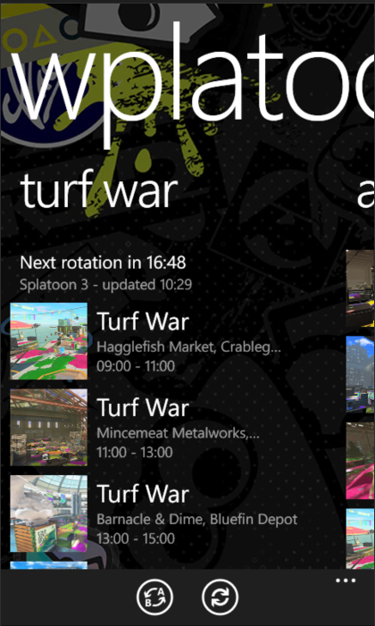
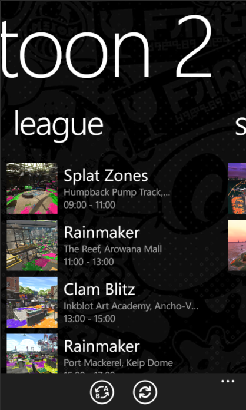
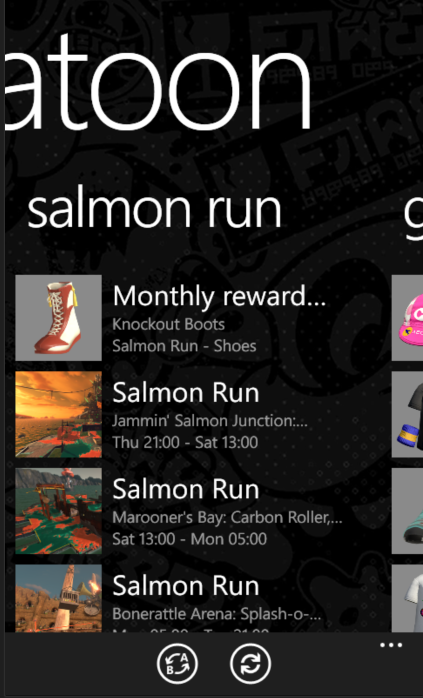
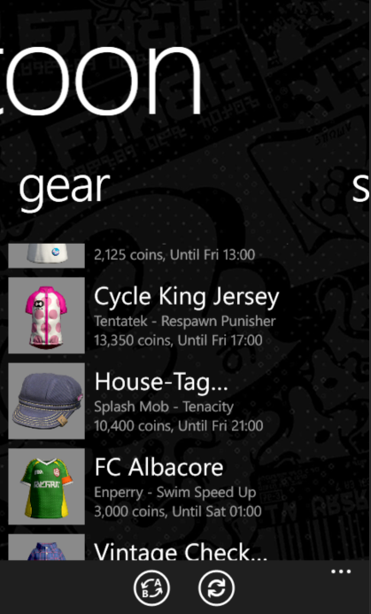

Everything works thanks to [misenhower](https://github.com/misenhower/)'s project, [Splatoon3.ink](https://github.com/misenhower/splatoon3.ink) and [Splatoon2.ink](https://github.com/misenhower/splatoon2.ink). 

It uses https://splatoon3.ink/data/schedules.json and https://splatoon2.ink/data/schedules.json to load the things you see at the main page, using TLS, even though WP8.0 only supports older TLS versions, somehow ts worked, not even i expected it to work ok

If you're interested, go take a look at https://github.com/misenhower/splatoon3.ink/wiki/Data-Access and https://github.com/misenhower/splatoon2.ink/wiki/Data-access-policy yourself!

# Planned features:
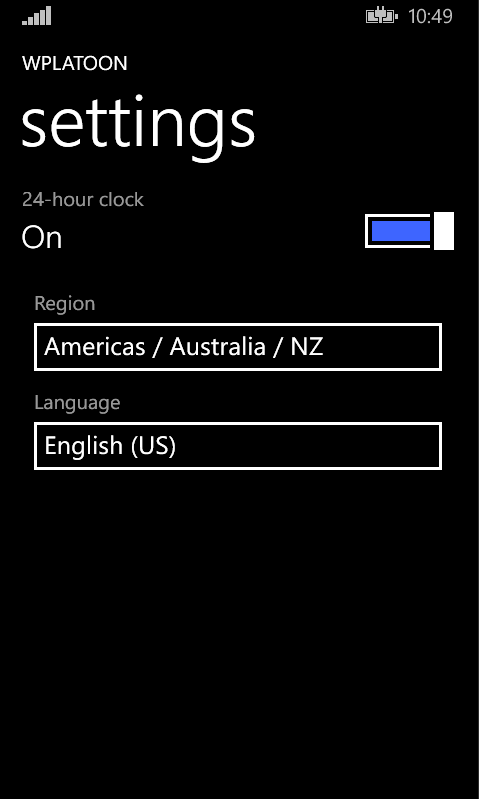

- Better app icon (like cmon bro, also mini app icon is kinda broken)
- Languages option actually functional
- Make About page open using Metrosurf and Metrocord instead of IE
- More explanation about the project at readme.md
- also make this readme have other languages...?
- fix github actions (broken)
- And better everything bro BRO

# What does it have (as of now):
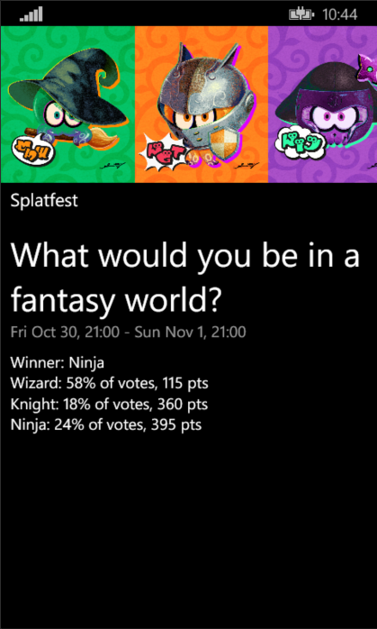
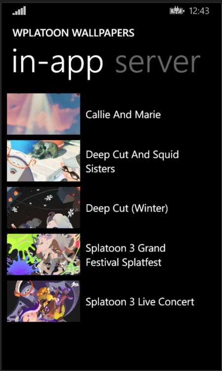
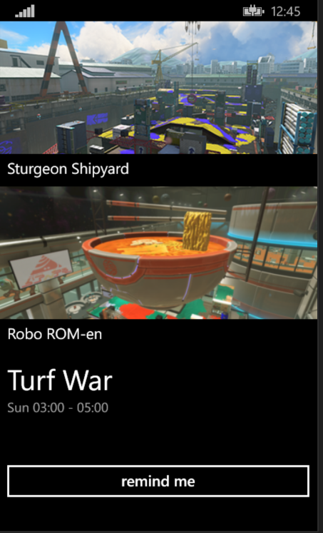
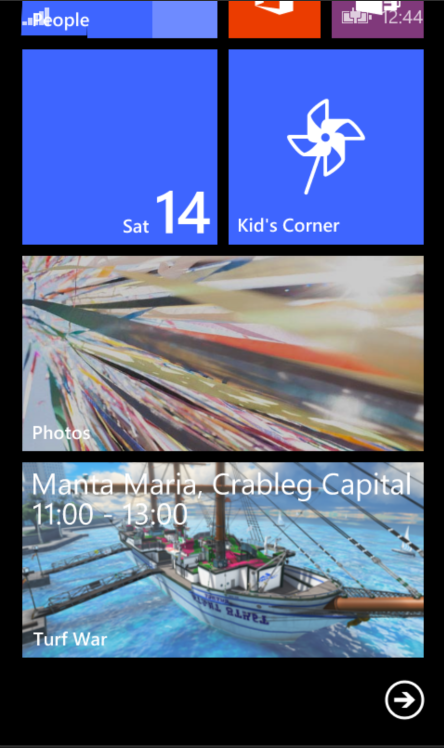

- Turf war
- Anarchy
- xbattles
- salmon run
- gears
- splatfests
- switch between splatoon 2 and 3
- ranked (splatoon 2)
- league (splatoon 2)
- event details (click on the tile at the menu)
- notify me button
- functional settings (At some point. you can change between 24h/12h scheme, and regional events)
- Splatoon wallpapers you can set (some are from the app, others are from splatoon3.ink, aka server)
- live tiles

# Special thanks:
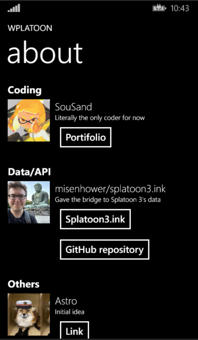

- misenhower for Splatoon3.ink and Splatoon2.ink
- Astro and MSN Money for initial project idea

# Want to get the latest sneak-peeks and help the project?
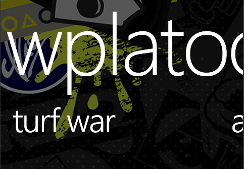

**Join our server!**

> https://discord.gg/ST2XwgM3jA

We need contributors and helpers, so, help if you don't mind!

If you want to contribute, make a fork and a pull request! 

Notes: this is COMPLETELY voluntary, we earn NOTHING from doing this
The app can be quite slow to read data (specially images), this isn't the apps fault, but windows phone's limits and capabilities
This project is not affiliated with misenhower (other than using his repos), Nintendo or any trademark whatsoever 

# More information
This project is open-source! So is Splatoon3.ink and Splatoon2.ink!

I used Visual Studio Community 2015, GitHub Desktop and VS Code for this project btw
